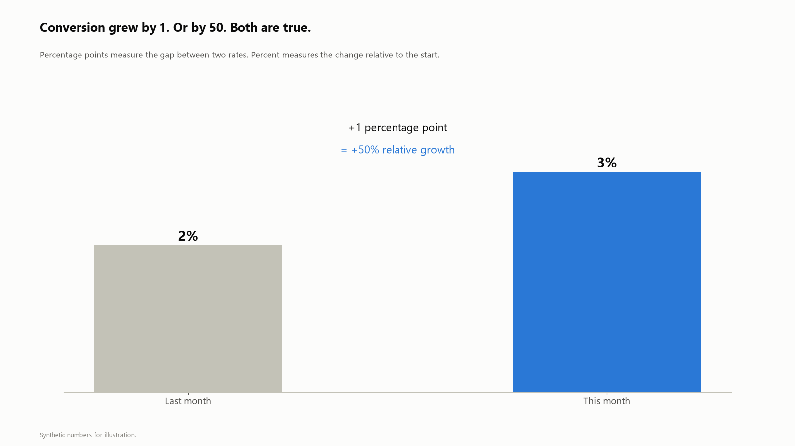
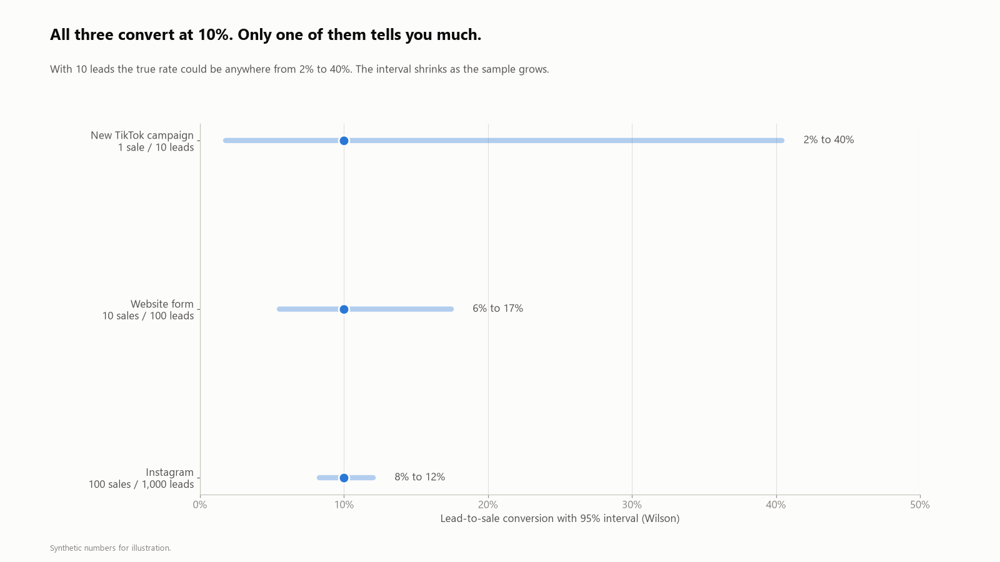
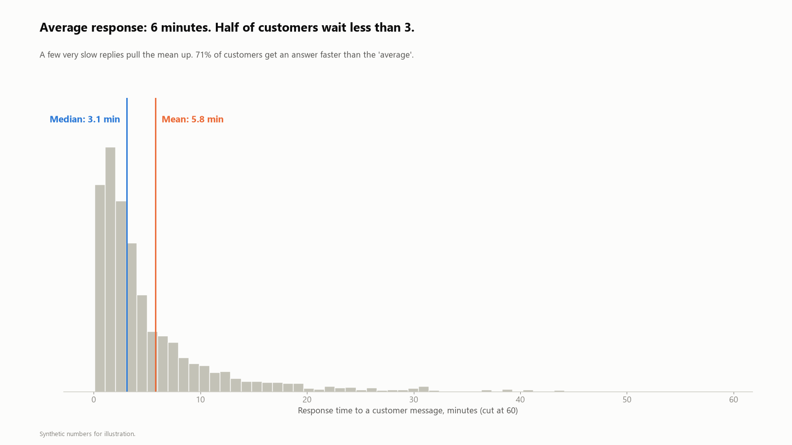
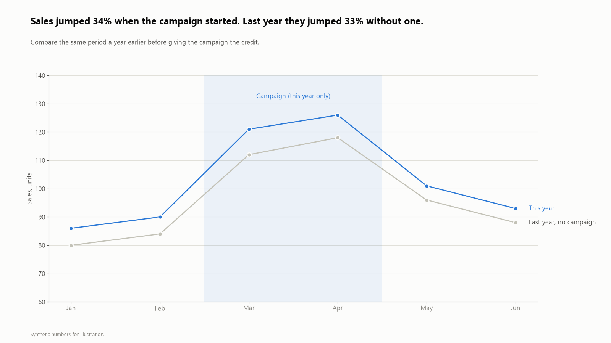

# Marketing Stats Pitfalls

Five ways a correct number can lead to a wrong decision in marketing and sales reporting. Each one is a single chart with synthetic numbers and a short rule I use at work.

I also write about these in plain language on [LinkedIn](https://www.linkedin.com/in/mirkazimkazimov) (in Azerbaijani).

**Stack:** Python · NumPy · matplotlib · no external stats library (the Wilson interval is 6 lines in [`src/pitfalls.py`](src/pitfalls.py))

---

### 1. Percent vs percentage points


From 2% to 3% is **+1 percentage point** and **+50%**. Say which one you mean. In a report I show the point change for rates and keep percent for volumes.

### 2. Small samples


1 out of 10, 10 out of 100 and 100 out of 1,000 are all 10%. The 95% Wilson interval shows how little 10 leads tell you: anything from 2% to 40%. Before ranking channels, I check how many leads sit behind each rate.

### 3. Simpson's paradox


Instagram and the call center both improve, the total gets worse, because the mix moved toward Instagram, the channel with the lower rate. A total is a weighted average. When it moves, I check the segments and the weights before the rates.

### 4. Mean vs median


Response times have a long tail. The mean says 6 minutes; half of customers wait less than 3, and 71% are faster than the "average". For skewed data I report the median and a high percentile (e.g. 90th) together.

### 5. Campaign or season?


Sales jumped 34% when the campaign started. They jumped 33% in the same month last year without one. Before giving credit, I compare with the same period a year earlier.

---

## Run it

```bash
pip install -r requirements.txt
python src/pitfalls.py   # writes images/*.png
```

All numbers are synthetic and chosen to make each point visible.
